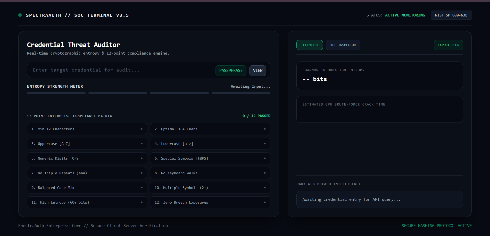
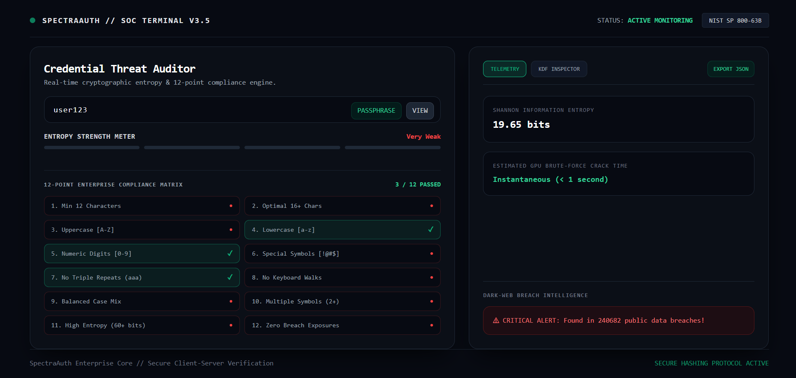
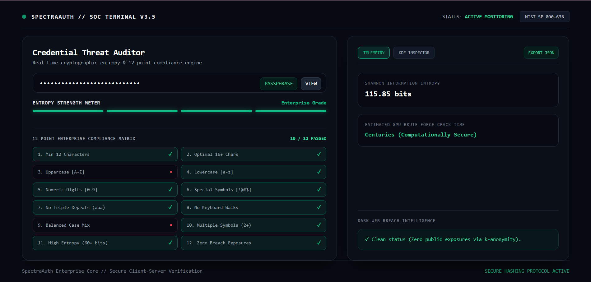
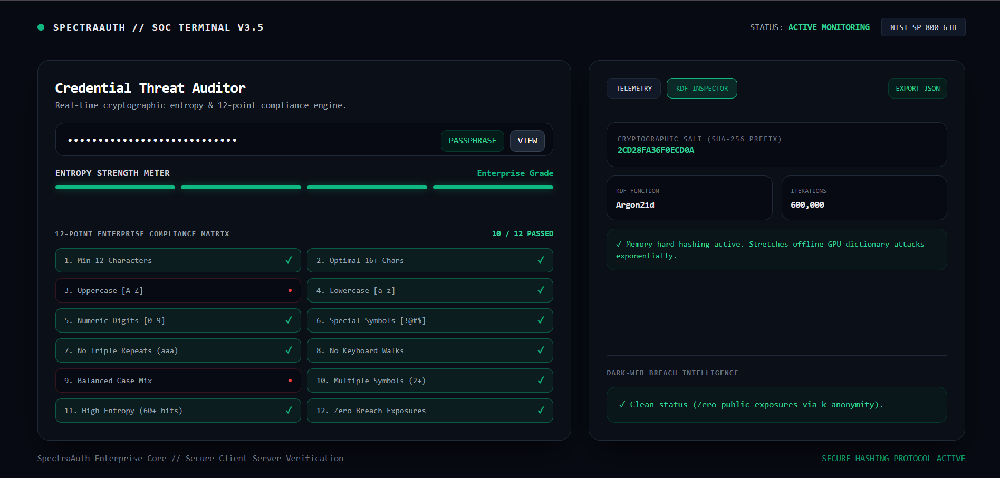

# 🛡️ SpectraAuth Enterprise // SOC Threat & Credential Auditor

<p align="center">
  <b>An Enterprise-Grade Credential Threat Auditor, Cryptographic Entropy Engine, and NIST SP 800-63B Compliance Analyzer.</b>
</p>

<p align="center">
  
  
  
  
</p>

---

## 🔍 Overview

**SpectraAuth Enterprise** is a high-performance security utility designed for security analysts, penetration testers, and enterprise administrators. Unlike standard password checkers that rely on naive regex checks, SpectraAuth combines **Shannon Information Entropy mathematics**, **GPU brute-force time estimation**, **Have I Been Pwned (HIBP) API k-Anonymity breach detection**, and a **12-Point Enterprise Policy Compliance Matrix** inside a futuristic Cyber-Emerald SOC dashboard.

---

## ✨ Key Enterprise Features

* **Mathematical Entropy Analysis:** Computes true cryptographic information density (bits) using Shannon Entropy formulas rather than basic character counts.
* **12-Point Compliance Matrix:** Validates passwords against rigorous corporate standards (length thresholds, case balance, numeric/symbol density, repetition limits, and keyboard walk detection).
* **Zero-Knowledge Breach Intelligence:** Integrates with the HIBP API using the **k-Anonymity model** (sending only the first 5 characters of the SHA-1 hash), ensuring raw credentials never leave the secure boundary.
* **GPU Brute-Force Simulation:** Calculates estimated time-to-crack based on high-end enterprise GPU cluster benchmarks (e.g., 100 Billion guesses/sec).
* **Diceware Passphrase Generator:** Generates cryptographically secure, high-entropy multi-word passphrases instantly.
* **KDF Inspector:** Inspects memory-hard hashing parameters (Argon2id / PBKDF2 iterations and salt generation).
* **Executive JSON Report Export:** Instantly downloads a structured JSON audit report for compliance documentation.

---

## 🖥️ UI & Dashboard Preview

| SOC Telemetry & Threat Analysis | 12-Point Policy Matrix |
| :---: | :---: |
|  |  |

| Diceware Passphrase Generator | KDF Inspector & JSON Export |
| :---: | :---: |
|  |  |

---

## 🛠️ Tech Stack

* **Backend:** Python, Flask, Gunicorn, Requests
* **Frontend:** Tailwind CSS, Modern Glassmorphism, Custom SOC Dark Terminal Aesthetic (`#070a12`)
* **Security APIs:** Have I Been Pwned (HIBP) Range API (k-Anonymity protocol)

---

## 🚀 Local Installation & Setup

1. **Clone the repository:**
   ```bash
   git clone [https://github.com/00axa/SPECTRAAUTH-Enterprise.git](https://github.com/00axa/SPECTRAAUTH-Enterprise.git)
   cd SPECTRAAUTH-Enterprise

 ## Create a virtual environment & activate it:

python -m venv venv
# On Windows:
venv\Scripts\activate
# On macOS/Linux:
source venv/bin/activate

## Install dependencies:

pip install -r requirements.txt

## Run the application:

python app.py
